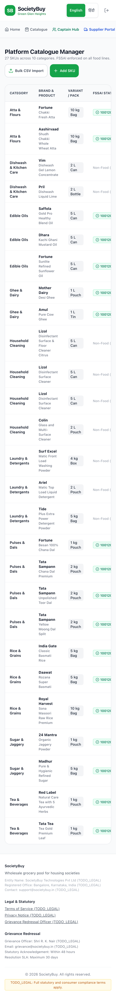
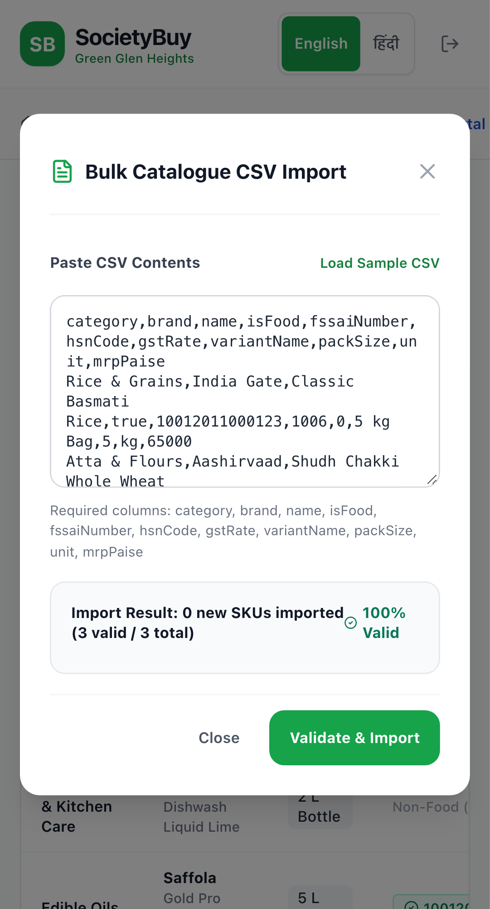
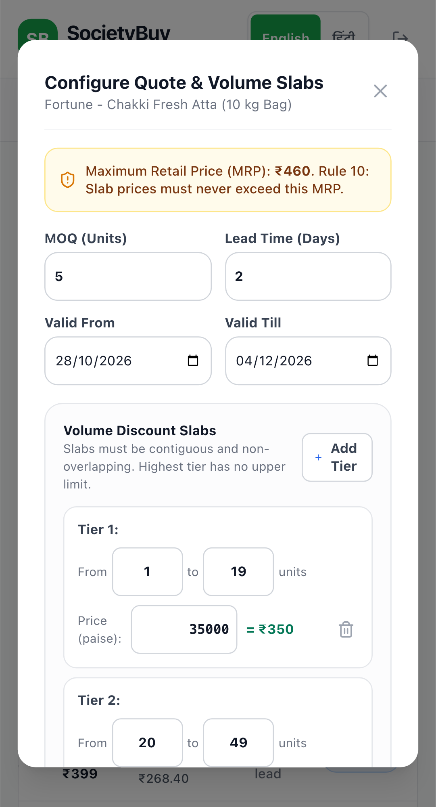
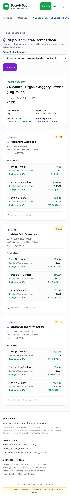

# Milestone 2 Walkthrough: Catalogue Manager, Supplier Quotes & Slabs, and Quote Comparison

Milestone 2 has been completed in strict accordance with the project rules and the user brief:
1. **Platform Admin Catalogue Manager** with categories, products, SKUs, and bulk CSV import with validation and error reporting.
2. **Supplier Portal Quote Editor** with interactive slabs, MOQ, validity dates, and lead time.
3. **Platform Admin Quote Comparison View** per SKU across competing wholesale suppliers.
4. **Pure Domain Validations** (`src/server/domain/*`) with 40 unit tests enforcing:
   - Food SKUs strictly require a valid 14-digit FSSAI license number.
   - Wholesale slab prices must never exceed the SKU's MRP (Rule 10).
   - Volume slabs must be contiguous and non-overlapping.
   - All prices strictly stored as integer paise (Rule 1).

---

## 1. Accomplishments & Implemented Modules

### 1.1 Pure Domain Logic (`src/server/domain/*`)
- **`slabValidation.ts`**:
  - Validates volume slabs: `minQty` must start at 1, slabs must be contiguous without gaps (`slab[i].minQty === slab[i-1].maxQty + 1`), only the final tier may have `maxQty = null`, and prices cannot increase at higher volume tiers.
  - Enforces **Rule 10**: `supplierPricePaise <= mrpPaise`.
  - Enforces **Rule 1**: Integer paise constraint on every price.
- **`catalogueValidation.ts`**:
  - Enforces mandatory 14-digit FSSAI license numbers for all food lines (`isFood = true`).
  - Exempts non-food household cleaning products.
  - Validates HSN codes, Indian GST tax brackets (0%, 5%, 12%, 18%, 28%), pack sizes, and standard units (`kg`, `L`, `piece`).
- **`csvParser.ts`**:
  - Parses CSV strings handling quoted cells, commas, and trims.
  - Generates line-by-line validation reports identifying the row number, failed field, exact failure reason, and raw line text.

### 1.2 State-Changing Service Layer (`src/server/services/*`)
- **`catalogueService.ts`**:
  - `createCategory`, `createProductAndSku`, and `importCatalogueFromCsv`.
  - Automatically matches or provisions categories during bulk import.
  - Records `CATALOGUE_CSV_IMPORTED` and `PRODUCT_AND_SKU_CREATED` to `audit_logs` (Rule 2).
- **`quoteService.ts`**:
  - `submitSupplierQuote`: Validates supplier access, deactivates prior quotes for the SKU, creates the new quote with slabs in a transaction, and writes `SUPPLIER_QUOTE_SUBMITTED` to `audit_logs`.
  - `getQuotesComparisonForSku`: Gathers all active supplier quotes for an SKU, computes resident prices with platform margin, and computes customer savings percentage vs MRP.

### 1.3 User Interface & Portals
- **Platform Admin Catalogue Manager (`/admin/catalogue`)**:
  - Visual breakdown of 25+ SKUs with FSSAI compliance badges.
  - Modal for interactive Bulk CSV Import with sample template and line-by-line error reports.
- **Platform Admin Quote Comparison View (`/admin/quotes`)**:
  - Dropdown selector across all SKUs.
  - Side-by-side supplier cards with supplier ratings, GSTIN, MOQ, lead time, and volume slab discount ladders.
- **Supplier Portal Quote Editor (`/supplier/quotes`)**:
  - Interactive slab builder allowing suppliers to configure MOQ, lead time, validity dates, and add/remove volume tiers with live MRP warnings.

---

## 2. Visual Walkthrough & Screenshots

### 2.1 Platform Admin Catalogue Manager & Bulk CSV Import
The catalogue manager displays the entire product portfolio with FSSAI license verification badges and quote counts. The CSV modal validates every row before import.

| Catalogue Manager (`/admin/catalogue`) | Bulk CSV Import with Validation Report |
| :---: | :---: |
|  |  |

### 2.2 Supplier Quote Editor & Admin Quote Comparison
Suppliers can configure volume tiers with MOQ and validity. Admins can view side-by-side quote comparisons per SKU with consumer prices and savings calculations.

| Supplier Slabs Editor (`/supplier/quotes`) | Quote Comparison Matrix (`/admin/quotes`) |
| :---: | :---: |
|  |  |

---

## 3. Test & Verification Results

### 3.1 Typecheck (`pnpm typecheck`)
```
$ tsc --noEmit
✓ Exited with code 0 (Zero type errors)
```

### 3.2 Lint (`pnpm lint`)
```
$ next lint
✔ No ESLint warnings or errors
```

### 3.3 Vitest Unit Tests (`pnpm test`) - 40/40 Tests Passing
```
 ✓ tests/unit/slabValidation.test.ts (8 tests)
   - accepts valid, contiguous, non-overlapping price slabs
   - throws SlabValidationError if price exceeds MRP (Rule 10)
   - throws SlabValidationError if slabs overlap
   - throws SlabValidationError if slabs have gaps
   - throws SlabValidationError if first slab does not start at 1
   - throws SlabValidationError if non-last slab has null maxQty
   - throws SlabValidationError if price increases at higher volume tier
   - throws if money is not integer paise (Rule 1 enforcement)
 ✓ tests/unit/catalogueValidation.test.ts (5 tests)
   - validates food product with valid 14-digit FSSAI license
   - throws CatalogueValidationError if food product lacks FSSAI
   - throws CatalogueValidationError if food FSSAI is not 14 digits
   - allows non-food products without FSSAI
   - validates SKU integer paise MRP and units
 ✓ tests/unit/csvParser.test.ts (4 tests)
   - parses valid CSV with food and non-food items
   - handles mrpRupees column by converting to integer paise
   - reports line-by-line validation errors with row numbers
   - reports missing headers error
 ✓ tests/unit/quoteService.test.ts (2 tests)
   - submits a new quote with valid slabs and records audit log
   - compares quotes across suppliers for an SKU
 ✓ tests/unit/authGuards.test.ts (5 tests)
 ✓ tests/unit/money.test.ts (5 tests)
 ✓ tests/unit/adapters.test.ts (4 tests)
 ✓ tests/unit/audit.test.ts (1 test)
 ✓ tests/unit/seedAuthRoles.test.ts (6 tests)

Test Files  9 passed (9)
     Tests  40 passed (40)
  Duration  298ms
```

### 3.4 Playwright End-to-End Tests (`pnpm test:e2e`) - 10/10 Tests Passing
```
Running 10 tests using 5 workers
  ✓ [Mobile Chrome] Supplier can view quote editor and submit volume slabs (1.8s)
  ✓ [Desktop Chrome] Supplier can view quote editor and submit volume slabs (1.6s)
  ✓ [Mobile Chrome] Platform Admin can view catalogue, open CSV import, and compare quotes across suppliers (2.2s)
  ✓ [Desktop Chrome] Platform Admin can view catalogue, open CSV import, and compare quotes across suppliers (1.9s)
  ✓ [Mobile Chrome] Resident can login via demo quick button (979ms)
  ✓ [Desktop Chrome] Resident can login via demo quick button (569ms)
  ✓ [Mobile Chrome] User can view home page, toggle language, and login as Captain (1.4s)
  ✓ [Desktop Chrome] User can view home page, toggle language, and login as Captain (915ms)
  ✓ [Mobile Chrome] Milestone 1 Screenshots (4.5s)
  ✓ [Desktop Chrome] Milestone 1 Screenshots (2.6s)

10 passed (7.4s)
```

---

## 4. Acceptance Criteria Verification

| Requirement | Status | Evidence |
| :--- | :---: | :--- |
| **Supplier can submit quotes** | **PASSED** | Verified via UI, `quoteService.test.ts`, and Playwright E2E test. Slabs, MOQ, lead time, and validity saved to DB. |
| **Admin can compare quotes across suppliers for any SKU** | **PASSED** | Verified at `/admin/quotes` with side-by-side supplier cards, rating badges, slab tables, and consumer price calculations. |
| **Food SKU needs FSSAI** | **PASSED** | Enforced by `catalogueValidation.ts`, rejected in CSV import if missing/invalid, verified by unit tests. |
| **Price never above MRP** | **PASSED** | Enforced by `slabValidation.ts`, rejected with `cannot exceed MRP` error, verified by unit tests. |
| **Slabs must not overlap** | **PASSED** | Contiguity and non-overlap enforced, verified by unit tests. |
