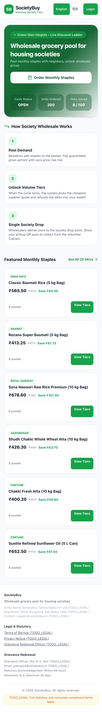
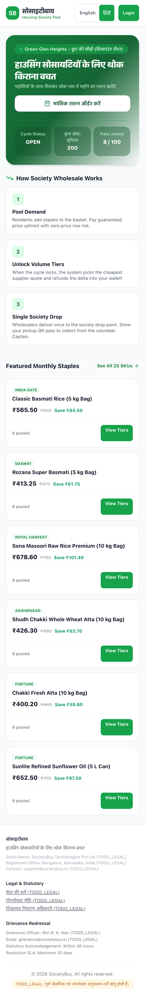
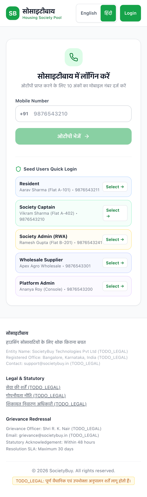
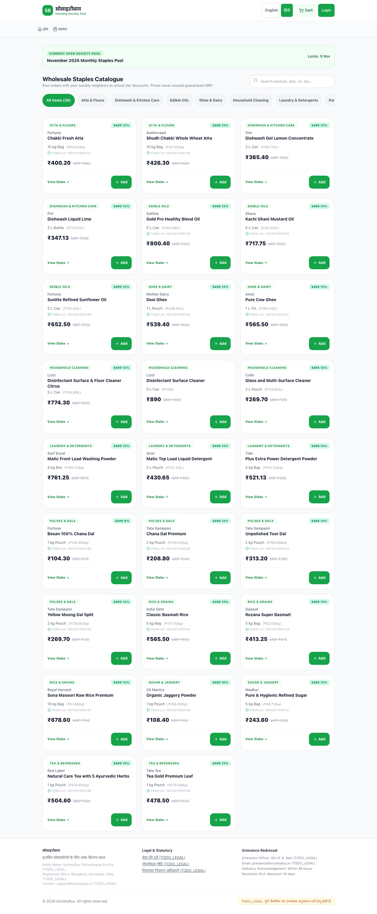

# Milestone 1 Walkthrough: Project Scaffolding & Core Infrastructure

SocietyBuy MVP has been successfully scaffolded with the exact stack from `GEMINI.md`:
**Next.js 14 App Router, TypeScript (strict), Tailwind CSS, PostgreSQL with Prisma, Zod, Vitest, and Playwright**.

---

## 1. Accomplishments & Implemented Modules

### 1.1 Complete Database Architecture (`prisma/schema.prisma`)
All 36 models, relations, enums, and indexes were implemented and pushed to PostgreSQL:
- **Core Entities:** `Society`, `DropPoint`, `User`, `Flat`, `Membership` (multi-role, multi-society).
- **Catalogue & Pricing:** `Category`, `Product`, `Sku`, `SupplierQuote`, `QuoteSlab`, `BenchmarkPrice`.
- **Aggregation & Cycles:** `Cycle`, `CycleSku`, `Order`, `OrderItem`.
- **Payments & Wallets:** `Payment`, `Refund`, `Wallet`, `WalletTransaction`, `ProviderEvent` (idempotency).
- **Procurement & Operations:** `Supplier`, `SupplierUser`, `PurchaseOrder`, `PurchaseOrderItem`, `GoodsReceipt`, `GoodsReceiptItem`, `Delivery`, `HandoverEvent`, `Invoice`.
- **Grievance, Audit & Compliance:** `Ticket`, `TicketMessage`, `Notification`, `Consent`, `Referral`, `CaptainCredit`, `AuditLog`.

### 1.2 Integer Paise Money Helper (`src/lib/money.ts`)
- **Rule 1 Enforcement:** All currency is strictly integer paise.
- `formatINR(paise)` formats with standard Indian numbering (`₹1,23,456` and `₹1,23,456.50`).
- Throws `TypeError` on any float input.

### 1.3 State-Change Audit Logging (`src/server/services/auditService.ts`)
- **Rule 2 Enforcement:** Immutable recording of `actorId`, `action`, `entity`, `entityId`, `before`, `after`, and `ipAddress` for all system mutations.

### 1.4 Zero-Key External Adapters (`src/server/adapters/*`)
- **Rule 7 Enforcement:**
  - `MockOtpAdapter`: Logs to console and accepts fixed test OTP `123456`.
  - `MockPaymentAdapter`: Simulates UPI intent, cards, instant success, failure toggling, and delayed webhooks.
  - `MockNotificationAdapter`: Logs and records in-app, WhatsApp, and SMS alerts to DB.

### 1.5 Role-Based Authentication & Cross-Society Isolation (`src/server/auth/*`)
- **Rule 5 Enforcement:**
  - Phone OTP flow with signed JWT session cookies via `jose`.
  - `requireAuth`, `requireRole`, `requireSocietyAccess`, `requireSupplier`, `requirePlatformAdmin`.
  - Rejects cross-society access with `CrossSocietyAccessError`.

### 1.6 Bilingual Localization (`src/i18n/*`)
- **Rule 8 Enforcement:** English and Hindi (`हिंदी`) dictionary with instant client-side switching and localStorage persistence.

### 1.7 Seed & Reset Infrastructure (`prisma/seed.ts`, `prisma/reset.ts`)
- **`pnpm reset`**: Wipes all database tables in clean reverse topological order.
- **`pnpm seed`**:
  - 1 demo society (*Green Glen Heights*, 100 flats, 2 towers)
  - 1 Captain (*Vikram Sharma*, Flat A-402)
  - 1 Society Admin / RWA (*Ramesh Gupta*, Flat B-201)
  - 30 Residents across 30 flats
  - 3 Wholesale Suppliers (*Apex Agro*, *Metro Bulk*, *Bharat Staples*) with portal accounts
  - 25 realistic Indian grocery SKUs across 10 categories with 3-tier wholesale slabs
  - Mandatory FSSAI numbers on all 18 food SKUs
  - 1 `OPEN` cycle with 8 paid orders (at 40% of tier 1)
  - 10 benchmark prices for retail price comparison (Blinkit, Zepto, Kirana)

---

## 2. Visual Walkthrough & Screenshots

### 2.1 Mobile Resident Home Page (English & Hindi)
The mobile-first UI (360px viewport) displays the live cycle countdown, society pooled units progress, how it works ladder, and featured staples with instant bilingual toggle.

| English View | Hindi View (`हिंदी`) |
| :---: | :---: |
|  |  |

### 2.2 Login Screen & Seed Users Quick Login
The login screen features phone OTP input and a one-click **"Seed Users Quick Login"** selector for all 5 roles:
Resident, Society Captain, Society Admin (RWA), Wholesale Supplier, and Platform Admin.

| Login Screen with Demo Roles | 25-SKU Catalogue with 3-Tier Ladders |
| :---: | :---: |
|  |  |

---

## 3. Test & Verification Results

### 3.1 Typecheck (`pnpm typecheck`)
```
$ tsc --noEmit
✓ Exited with code 0 (Zero type errors)
```

### 3.2 Lint (`pnpm lint`)
```
$ next lint
✔ No ESLint warnings or errors
```

### 3.3 Vitest Unit Tests (`pnpm test`)
```
 ✓ tests/unit/authGuards.test.ts (5 tests)
   - requireAuth throws UnauthorizedError if no session is present
   - requireRole allows permitted role and blocks others
   - enforces cross-society access protection (Rule 5)
   - requireSupplier validates supplier role and ID
   - requirePlatformAdmin only allows platform admin
 ✓ tests/unit/money.test.ts (5 tests)
   - formats standard integer paise into Indian currency with comma grouping
   - formats paise with remainder properly
   - formats zero and negative paise values correctly
   - throws TypeError if a float is passed (Rule 1 integer paise)
   - converts rupees to paise and vice versa
 ✓ tests/unit/adapters.test.ts (4 tests)
   - MockOtpAdapter sends and verifies OTP
   - MockPaymentAdapter creates orders and verifies signatures
   - MockPaymentAdapter simulates failure when configured
   - MockNotificationAdapter creates notification record
 ✓ tests/unit/audit.test.ts (1 test)
   - records an audit log with actor, action, entity, before, after, timestamp
 ✓ tests/unit/seedAuthRoles.test.ts (6 tests)
   - authenticates Resident from seed data and produces valid session
   - authenticates Captain from seed data and produces CAPTAIN role
   - authenticates Society Admin from seed data and produces SOCIETY_ADMIN role
   - authenticates Supplier from seed data and produces SUPPLIER role with supplierId
   - authenticates Platform Admin from seed data and produces PLATFORM_ADMIN role
   - rejects invalid OTP

Test Files  5 passed (5)
     Tests  21 passed (21)
```

### 3.4 Playwright End-to-End Tests (`pnpm test:e2e`)
```
Running 4 tests using 4 workers
  ✓ [Mobile Chrome] Resident can login via demo quick button (817ms)
  ✓ [Desktop Chrome] Resident can login via demo quick button (816ms)
  ✓ [Mobile Chrome] User can view home page, toggle language, and login as Captain (967ms)
  ✓ [Desktop Chrome] User can view home page, toggle language, and login as Captain (967ms)

4 passed (3.6s)
```

### 3.5 Database Scripts Verification
- `pnpm seed`: Cleanses and seeds all 100 flats, 33 users, 3 suppliers, 25 SKUs with quotes, and 1 OPEN cycle.
- `pnpm reset`: Cleanly wipes all 36 tables in reverse topological order.
